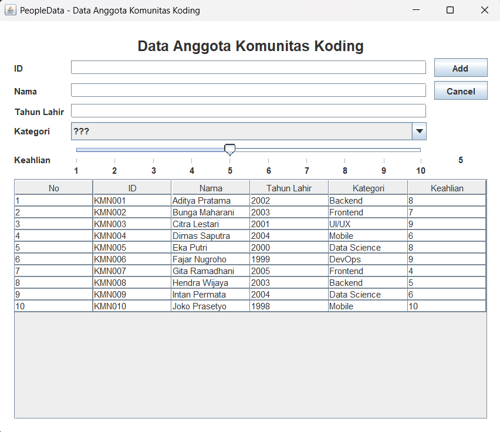
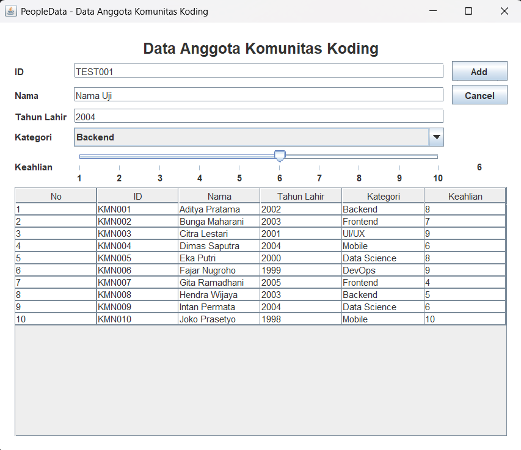
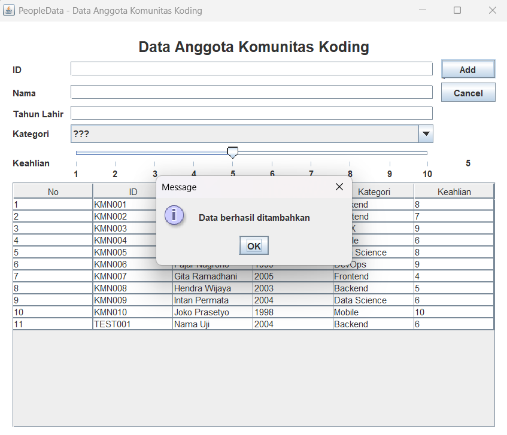
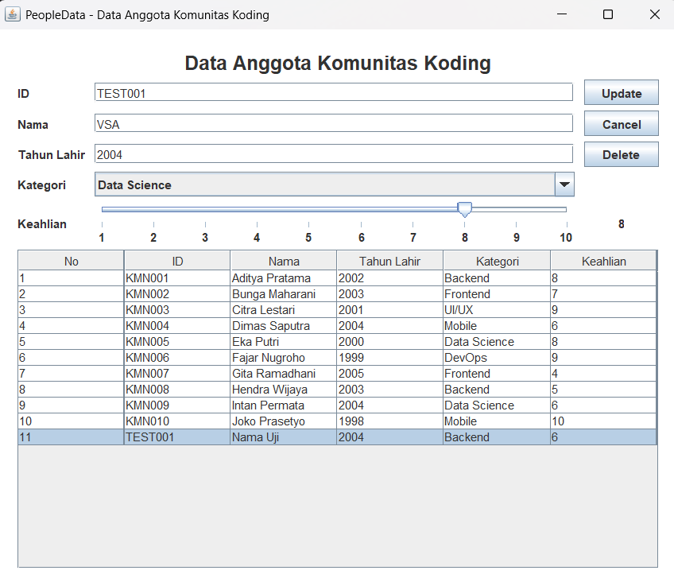
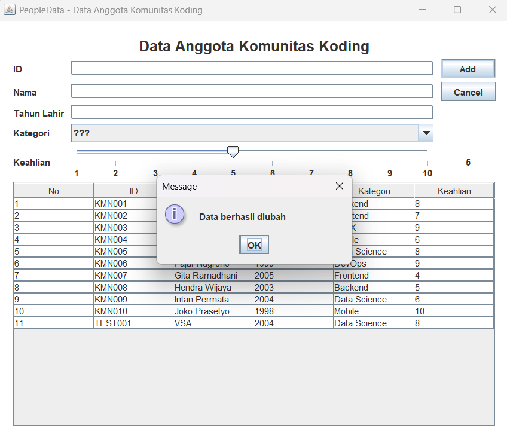
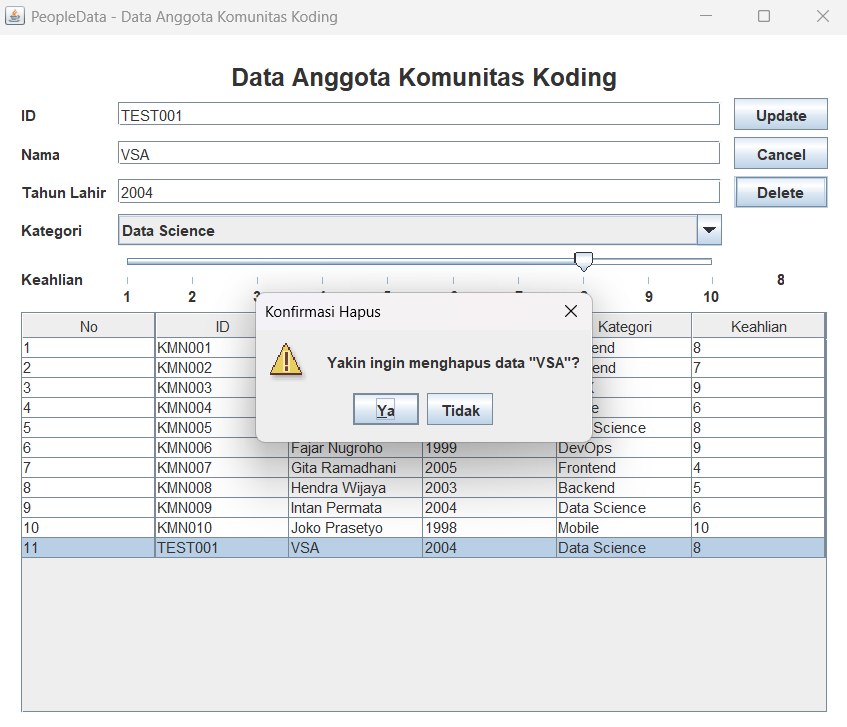
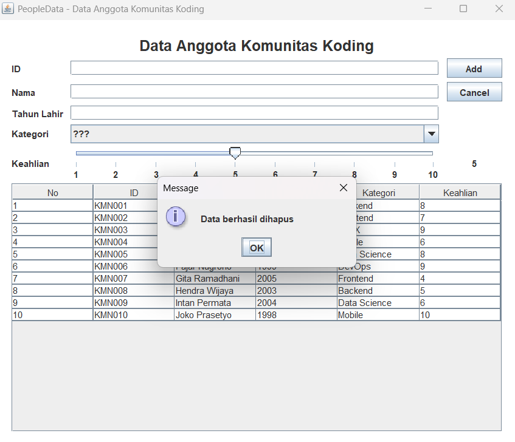

# TP4 DPBO — PeopleData (Java Swing GUI)

## Janji
Saya **Vanisha Septiani Auliaputri** dengan **NIM 2510735** mengerjakan Tugas Praktikum 4 dalam mata kuliah Desain dan Pemrograman Berorientasi Objek untuk keberkahanNya maka saya tidak melakukan kecurangan seperti yang telah dispesifikasikan. Aamiin.

## 1. Desain dan Fungsi Program

### 1.1 Tema dan Atribut

Tema aplikasi adalah **Data Anggota Komunitas Koding**. Empat atribut awal yang diminta pada tugas adalah ID, Nama, Tahun Lahir, dan Kategori. Atribut tambahan yang digunakan adalah **Keahlian**, dengan nilai 1–10 yang diatur melalui `JSlider`.

| Atribut | Tipe data | Komponen GUI | Keterangan |
|---|---|---|---|
| `id` | `String` | `JTextField` | ID anggota, misalnya `KMN001`; tidak boleh kosong atau duplikat. |
| `nama` | `String` | `JTextField` | Nama anggota; tidak boleh kosong. |
| `tahunLahir` | `int` | `JTextField` | Tahun lahir berupa angka, dari 1900 sampai tahun berjalan. |
| `kategori` | `String` | `JComboBox` | Bidang komunitas: Backend, Frontend, Mobile, Data Science, DevOps, atau UI/UX. |
| `keahlian` *(atribut tambahan)* | `int` | `JSlider` dan `JLabel` | Tingkat keahlian dari 1 sampai 10; angka aktif ditampilkan di samping slider. |

Atribut tambahan `keahlian` menggunakan **`JSlider`, bukan `JTextField`**, sesuai pilihan komponen bonus pada modul.

### 1.2 Komponen GUI

| Nama komponen | Jenis | Fungsi |
|---|---|---|
| `mainPanel` | `JPanel` | Panel utama aplikasi. |
| `titleLabel` | `JLabel` | Menampilkan judul aplikasi. |
| `idField` | `JTextField` | Input ID anggota. |
| `namaField` | `JTextField` | Input nama anggota. |
| `tahunLahirField` | `JTextField` | Input tahun lahir. |
| `kategoriComboBox` | `JComboBox` | Memilih kategori; `???` merupakan pilihan awal dan tidak dapat disimpan sebagai kategori. |
| `keahlianSlider` | `JSlider` | Memilih tingkat keahlian 1–10. |
| `keahlianValueLabel` | `JLabel` | Menampilkan angka pada slider yang sedang dipilih. |
| `addUpdateButton` | `JButton` | Menjalankan Add saat mode tambah dan Update saat mode ubah. |
| `cancelButton` | `JButton` | Mengosongkan form dan kembali ke mode tambah. |
| `deleteButton` | `JButton` | Menghapus data yang dipilih setelah konfirmasi. |
| `peopleTable` | `JTable` | Menampilkan data anggota. Tabel berada di dalam `JScrollPane`. |

### 1.3 Fitur dan Validasi

- **Create:** menambah data baru melalui form dan tombol **Add**.
- **Read:** menampilkan seluruh data pada tabel. Klik baris untuk memuat data anggota ke form.
- **Update:** mengubah data pada baris yang dipilih melalui tombol **Update**.
- **Delete:** menampilkan dialog konfirmasi sebelum penghapusan. Data hanya dihapus jika pengguna memilih **Ya**; memilih **Tidak** membatalkan penghapusan.
- **Validasi:** ID dan nama tidak boleh kosong, tahun lahir harus berupa angka dalam rentang yang ditentukan, kategori harus dipilih, dan ID tidak boleh duplikat.
- **Data awal:** aplikasi menampilkan 10 data contoh yang dibuat melalui `populateList()`.
- **Tabel:** sel tabel tidak dapat diubah secara langsung; perubahan dilakukan melalui form.

Data disimpan di dalam `ArrayList<Person>` selama aplikasi berjalan, bukan ke database atau file. Karena itu, data tambahan atau perubahan akan kembali ke 10 data awal ketika aplikasi dijalankan ulang.

### 1.4 Class dan Method Utama

| Class / method | Fungsi |
|---|---|
| `Person` | Menyimpan atribut anggota beserta getter dan setter. |
| `PeopleMenu.main()` | Membuat dan menampilkan jendela aplikasi. |
| `PeopleMenu()` | Menginisialisasi data, tabel, combo box, slider, dan listener tombol/tabel. |
| `populateList()` | Mengisi 10 data awal. |
| `setTable()` | Membuat model tabel berdasarkan isi `listPerson`. |
| `insertData()` | Memvalidasi input dan menambah data baru. |
| `updateData()` | Memvalidasi input dan mengubah data yang dipilih. |
| `deleteData()` | Menghapus data yang dipilih setelah konfirmasi dari listener tombol Delete. |
| `clearForm()` | Mengosongkan form dan mengembalikan aplikasi ke mode tambah. |
| `isInputValid()` dan `showError()` | Memeriksa isian dan menampilkan pesan kesalahan. |

## 2. Struktur Folder Pengumpulan

```text
TP4DPBO2526C1/
├── PeopleData/
│   ├── Person.java
│   ├── PeopleMenu.java
│   └── PeopleMenu.form
├── Dokumentasi/
│   ├── 01-tampilan-awal.png
│   ├── 02-create-isi-form.png
│   ├── 03-create-berhasil.png
│   ├── 04-update-isi-form.png
│   ├── 05-update-berhasil.png
│   ├── 06-delete-konfirmasi.png
│   └── 07-delete-berhasil.png
└── README.md
```

## 3. Alur Program

1. Saat program dijalankan, constructor mengisi `listPerson` dengan data awal melalui `populateList()`, lalu menampilkan data pada `JTable` melalui `setTable()`.
2. Saat pengguna memilih sebuah baris, data pada baris tersebut dimuat ke form. Tombol **Add** berubah menjadi **Update**, dan tombol **Delete** ditampilkan.
3. Saat **Add** ditekan, input divalidasi. Jika valid, objek `Person` baru dimasukkan ke `listPerson` dan tabel diperbarui.
4. Saat **Update** ditekan, input divalidasi lalu data anggota yang dipilih diperbarui dan tabel ditampilkan kembali.
5. Saat **Delete** ditekan, dialog konfirmasi muncul. Memilih **Ya** menghapus data; memilih **Tidak** membatalkan penghapusan.
6. Tombol **Cancel** mengosongkan form, menghilangkan pilihan baris, dan mengembalikan tombol ke mode **Add**.

Variabel `selectedIndex` digunakan untuk mengetahui apakah aplikasi sedang dalam mode tambah (`-1`) atau mode ubah (index baris yang dipilih).

## 4. Dokumentasi Program

Screenshot berikut diambil ketika aplikasi dijalankan. File gambar disimpan di folder `Dokumentasi` dan ditautkan menggunakan path relatif agar dapat terlihat pada halaman README GitHub.

### 4.1 Tampilan Awal — Read

Tampilan awal memperlihatkan form kosong dan 10 data anggota yang sudah tersedia di dalam tabel.



### 4.2 Create — Mengisi Form

Data contoh `TEST001` diisi dengan nama `Nama Uji`, tahun lahir `2004`, kategori `Backend`, dan tingkat keahlian `6`. Screenshot ini diambil sebelum tombol **Add** ditekan.



### 4.3 Create — Berhasil Menambahkan Data

Setelah tombol **Add** ditekan, aplikasi menampilkan pesan bahwa data berhasil ditambahkan. Baris `TEST001` terlihat pada tabel.



### 4.4 Read dan Persiapan Update — Memilih Data

Baris `TEST001` dipilih sehingga datanya dimuat ke form. Pada screenshot ini, isian nama sudah diubah menjadi `VSA`, kategori menjadi `Data Science`, dan tingkat keahlian menjadi `8`, tetapi tombol **Update** belum ditekan. Karena itu, tabel masih menampilkan data sebelumnya (`Nama Uji`, `Backend`, dan `6`).



### 4.5 Update — Berhasil Mengubah Data

Setelah tombol **Update** ditekan, aplikasi menampilkan pesan bahwa data berhasil diubah. Tabel menunjukkan nilai baru untuk `TEST001`, yaitu nama `VSA`, kategori `Data Science`, dan tingkat keahlian `8`.



### 4.6 Delete — Konfirmasi Sebelum Menghapus

Saat tombol **Delete** ditekan, dialog meminta konfirmasi. Data belum dihapus sampai pengguna memilih **Ya**.



### 4.7 Delete — Berhasil Menghapus Data

Setelah penghapusan dikonfirmasi, aplikasi menampilkan pesan berhasil dihapus. Baris `TEST001` sudah tidak ada di tabel sehingga jumlah data kembali menjadi 10.


